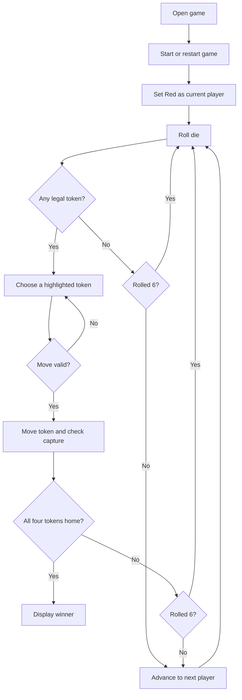

# Classic Ludo

## Project Structure

```text
ludo/
|-- index.html   Game layout and controls
|-- style.css    Board appearance and responsive layout
|-- script.js    Turn, dice, movement, capture, and win logic
`-- README.md    Project report and run instructions
```

## Project Title

**Classic Ludo: A Browser-Based Four-Player Board Game**

## Introduction

Classic Ludo is a local, pass-and-play board game built with HTML, CSS, and vanilla JavaScript. Four players take turns rolling one virtual die and moving their colored tokens around a shared track toward the center. The project demonstrates how a browser interface can represent a board, track game state, enforce rules, and respond to player input without a framework or server-side service.

## Problem Statement

A physical Ludo game needs a board, tokens, and a die, and players must track turns and rules themselves. This project provides a simple digital version that displays the board and game state, accepts player actions, and applies movement, capture, safety, and winning rules consistently.

## Objectives

- Build a responsive Ludo board in HTML and CSS.
- Use JavaScript to handle dice rolls, turns, legal moves, token capture, and winning.
- Give clear feedback about the current player and each game action.
- Keep the source code small and understandable for a BCA semester project.

## Scope

This version supports four human players sharing one computer or mobile device. It is a single local game session with no sign-in, network play, saved scores, or automated opponents. A page refresh starts a fresh session.

## Features

- Four colored player bases with four tokens per player.
- A 52-square shared path, colored home lanes, starting squares, safe squares, and a center finish.
- A tappable, animated 3D die with pip faces; the result is also announced in the game message.
- Live circular progress percentages inside each colored home base, averaged across all four tokens from 0% in base to 100% at the finish, with a 🔥 near-win indicator.
- Temporary event emojis for rolls, movement, safe squares, home entry, captures, extra turns, and wins.
- Separate sound effects for dice, movement, capture, safe squares, home, wins, and extra turns, with a Sound On/Off button.
- Player-owned custom reaction favorites, animated board reactions, individual sounds, and a short send cooldown.
- A 6 is required to take a token out of base, and taking a token out uses that roll.
- Moves automatically when there is one legal token or all of a player's tokens share one position; otherwise the player chooses a highlighted legal token.
- A 6 grants another turn.
- Only moves that fit the track and reach home exactly are allowed.
- Landing on opponent tokens on an unsafe shared-track square immediately returns all opponents sharing the square to base, with a flash animation, capture sound, and message.
- Safe shared-track squares and home lanes cannot be captured.
- The game identifies when all four tokens of a player reach the center.
- Start, roll, restart, turn highlighting, move feedback, and per-player home counts.
- Layout adapts to desktop and mobile screens.

## Hardware and Software Requirements

**Hardware:** Any modern desktop, laptop, tablet, or phone capable of running a current web browser.

**Software:** Visual Studio Code and a modern browser such as Microsoft Edge, Google Chrome, or Firefox. No framework, package manager, database, or extension is required.

## System Requirements

The browser must support standard HTML5, CSS Grid, and modern JavaScript (ES6 or later). The project runs offline once the three source files are on the device. It does not require a particular operating system.

## Modules

1. **Board module:** Creates the 15-by-15 board and marks bases, track squares, safe squares, start squares, home lanes, and center.
2. **Dice and turn module:** Rolls a value from 1 to 6, highlights the current player, and manages extra turns after a 6.
3. **Movement module:** Determines legal tokens, applies movement, requires exact arrival at home, and blocks invalid moves.
4. **Capture module:** Finds opponent tokens sharing an unsafe track square and returns them to base.
5. **Winner and restart module:** Detects four finished tokens and initializes a new game.
6. **User interface module:** Displays controls, messages, dice results, turn state, and player home counts.

## Database Requirement

A database is **not required**. Game state exists only in JavaScript memory during the current browser session. The game has no user accounts, persistent records, or shared data. A database could be added later for profiles or saved match history.

## System Flowchart



## Algorithm

1. Create four players, each with four tokens at progress `-1` (base); set the current player to Red.
2. When the active player rolls the die, generate an integer from 1 through 6.
3. A token in base is legal only when the roll is 6. Moving it out places it on that player's starting square.
4. For a token already moving, add the die value to its progress only if the result does not pass the final home position.
5. If the destination is an unsafe shared-track square, return any opponents on that square to base. Do not capture on a safe square or in a home lane.
6. If all four tokens have reached the center, display the active player's win message and stop the game.
7. Otherwise, keep the turn after a 6; after another number, advance to the next player.
8. Restart by returning every token to base and restoring the initial turn and controls.

## Setup and Running in VS Code

1. Create a folder named `ludo` in a location you can easily find.
2. In VS Code, select **File > Open Folder...** and open that folder.
3. In the Explorer, create `index.html`, `style.css`, `script.js`, and optionally `README.md`.
4. Paste the matching code into each file. Keep all four files in the same folder.
5. Save the files. No dependencies or build step are needed.
6. Open `index.html` in a browser. You can use **File > Open File** from the browser, or install the optional **Live Server** extension and select **Open with Live Server** in VS Code.
7. Tap the die in the center of the board to start the game as Red and roll, or select **Start Game** first. When prompted, choose a highlighted token. Players take turns on the same device.
8. Use **Restart Game** to reset the current match.

If this project is in the XAMPP web root at `htdocs/ludo`, you can also start Apache in the XAMPP Control Panel and visit `http://localhost/ludo/`.

## How to Test the Game

- Start a game and verify that Red is highlighted and the die control is enabled.
- Roll until a 6 appears. Verify that base tokens become selectable; roll a non-six and verify that tokens still in base cannot move.
- Move a token around the track. Verify that only highlighted tokens can move, the turn changes after a non-six, and a six grants another roll.
- Move tokens onto safe squares and verify they remain safe; land on an opponent at a non-safe shared-track square and verify the opponent returns to base.
- Check that a token cannot pass the center with an oversized roll and that a finished token cannot move again.
- Finish all four tokens for a player and verify the winner message. Restart and confirm the board resets.
- Resize the browser or test on a phone-sized viewport to verify the board and controls fit.

## Conclusion

The project turns Ludo's central rules into a small interactive web application. Its separate HTML, CSS, and JavaScript files make the interface, styling, and game logic easier to study, test, and explain. It also demonstrates state management, arrays and objects, event handling, conditional logic, and responsive layout.

## Future Enhancements

- Add computer-controlled players and online multiplayer.
- Add a choice of rule sets, such as three sixes ending a turn.
- Add animations, sound effects, and a move history.
- Save statistics or match history with local storage or a database.
- Add automated tests for turn, movement, capture, and win scenarios.

## Possible Viva Questions and Answers

**1. What technologies are used?**  
HTML defines the page, CSS styles the board and responsive layout, and JavaScript implements the game rules and interactions.

**2. Why did you use vanilla JavaScript instead of a framework?**  
The project is small, so plain JavaScript keeps setup simple and makes the game logic easier to follow for this demonstration.

**3. How is a token's position represented?**  
Each token stores one progress number: `-1` means base, `0` through `50` means the shared track, and `51` through `56` means the home lane and center.

**4. How does the game decide whether a move is legal?**  
It checks that a token can leave base only on a 6 and that an active token will not pass the final progress value of `56`.

**5. How are captures implemented?**  
The game compares the moved token's shared-track index with each opponent's. Matching opponent tokens are returned to progress `-1`, unless the destination is marked safe.

**6. Why is there no database?**  
Only the current match is needed, and it lives in browser memory. There are no accounts or persistent records to store.

**7. How does the game detect a winner?**  
After a move, it checks whether all four tokens belonging to the active player have progress `56`.

**8. How is responsive behavior achieved?**  
CSS Grid builds the board, a square aspect ratio preserves its shape, and media queries rearrange the controls and adjust spacing on narrow screens.

**9. What happens when a player has no legal moves?**  
The game shows that no move is available, then advances the turn. If the player rolled a 6, the same player rolls again.

**10. What could be improved in a future version?**  
Computer players, network play, persistent statistics, animation, and automated rule tests are possible extensions.
